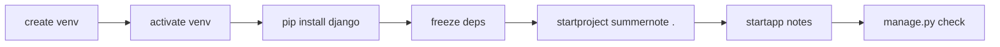

# Phase 1.1 — Scaffold the Django project

## 🎯 Goal
Create a Django 5 project called `summernote` with its first app `notes`, inside a Python virtual environment, with dependencies pinned in `requirements.txt`.

## 🧠 Concepts you'll meet
- **Virtual environment (`venv`)** — a private Python+packages sandbox per project.
- **Django project vs app** — the two-level organization Django imposes.
- **`pip freeze` → `requirements.txt`** — reproducible installs.
- **`manage.py check`** — the first thing you run when "did I break anything?"

## 🤔 Why we're doing this now
Everything from here on assumes a Django project exists in a clean, isolated environment. Isolation (via `venv`) means our dependencies can't collide with any other project's — crucial once a machine has 20 Python projects.

## 🗺 Flow



## ⌨️ Commands — you type these

> All commands below assume you're inside your local SummerNote folder (`cd` into it first). Run `pwd` and `ls` to confirm; you should see `docs/` and `README.md`.

### 1. Create a virtual environment

```bash
python3 -m venv .venv
```

**What this does:** creates a folder `.venv/` containing a private Python interpreter and an empty `site-packages`. Nothing you install into it affects your system Python.
**Expected output:** no output. New folder `.venv/` appears.
**Why `.venv` and not `venv`?** Dot-prefix hides it in some file browsers and it's the de-facto convention. Our `.gitignore` already excludes `.venv/`.

### 2. Activate the virtual environment

```bash
source .venv/bin/activate
```

**What this does:** modifies your shell so `python` and `pip` resolve to the ones inside `.venv/`.
**Expected output:** your shell prompt now has `(.venv)` prepended.
**Verify:**
```bash
which python
which pip
```
Both paths should end in `.venv/bin/...`.

**On Windows (PowerShell):** `.venv\Scripts\Activate.ps1` instead.

### 3. Upgrade pip (good hygiene)

```bash
pip install --upgrade pip
```

### 4. Install Django

```bash
pip install "django>=5.0,<6.0"
```

**What this does:** installs the latest 5.x release of Django and its dependencies (`asgiref`, `sqlparse`).
**Expected output:** `Successfully installed asgiref-x.x django-5.x.x sqlparse-x.x.x`

### 5. Pin dependencies to `requirements.txt`

```bash
pip freeze > requirements.txt
```

**What this does:** writes the exact installed versions to a file so any teammate (or future you, or CI) can reproduce the environment with `pip install -r requirements.txt`.
**Verify:**
```bash
cat requirements.txt
```
You should see three lines (asgiref, django, sqlparse) with `==` version pins.

### 6. Scaffold the Django project

```bash
django-admin startproject summernote .
```

**What this does:** creates a Django **project** named `summernote` *in the current directory* (the trailing dot). Without the dot, Django would nest everything inside an extra `summernote/` folder.
**Expected result (new files/folders):**
- `manage.py` — your CLI entry point for Django commands.
- `summernote/` folder containing `__init__.py`, `settings.py`, `urls.py`, `asgi.py`, `wsgi.py`.

### 7. Scaffold the first app

```bash
python manage.py startapp notes
```

**What this does:** creates an **app** named `notes` — a feature module Django can plug into the project.
**Expected result:** new `notes/` folder with `admin.py`, `apps.py`, `migrations/`, `models.py`, `tests.py`, `views.py`.

### 8. Verify everything is wired correctly

```bash
python manage.py check
```

**Expected output:**
```
System check identified no issues (0 silenced).
```

If you see this, Django considers your project valid.

### 9. Peek at the file tree

```bash
ls -la
```

You should see:
```
.venv/           manage.py           requirements.txt
summernote/      notes/              docs/           README.md    .gitignore
```

## ✅ Validation — you've finished this phase when
- [ ] `which python` prints a path inside `.venv/`
- [ ] `pip list` includes `Django 5.x`
- [ ] `requirements.txt` exists and pins Django
- [ ] `manage.py` exists at the repo root
- [ ] `summernote/settings.py` exists
- [ ] `notes/models.py` exists
- [ ] `python manage.py check` prints *0 issues*

## 🧪 Try breaking it (optional)
1. Run `deactivate` and then `python manage.py check`. What error? Why? (Hint: outside the venv, Django isn't installed.) Re-activate with `source .venv/bin/activate`.
2. Open `summernote/settings.py` and look at `INSTALLED_APPS`. Notice `notes` is **not** there yet, even though we created the app. We'll add it in Phase 1.4 — why do you think the two actions are separate?
3. Delete `.venv/` (`rm -rf .venv`). Recreate it from scratch with `python3 -m venv .venv && source .venv/bin/activate && pip install -r requirements.txt`. **This is the magic of `requirements.txt`:** you can rebuild the environment anywhere.

## 📝 Reflect
- In your own words: what's the difference between a Django *project* and a Django *app*? If this were a startup codebase, how many apps might it eventually have?
- Why doesn't `.venv/` get committed to Git? What would go wrong if it did?
- Why do we pin dependency versions in `requirements.txt` instead of saying "install the latest"?

## 🔗 Deeper reading
- Django tutorial Part 1: https://docs.djangoproject.com/en/5.2/intro/tutorial01/
- Virtual environments: https://docs.python.org/3/library/venv.html

## ➡️ Next
`01-2-git-init.md` — initialize Git with a safe `.gitignore` and make your first commit.
