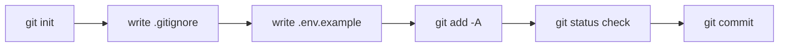

# Phase 1.2 — Git init + safe `.gitignore` + first commit

## 🎯 Goal
Put your scaffolded project under version control with a `.gitignore` that keeps secrets, caches, and local state out of history.

## 🧠 Concepts you'll meet
- **Working tree vs staging area vs commit** — the three Git areas.
- **`.gitignore`** — the file that tells Git "pretend you didn't see these."
- **`.env.example`** — the committed *shape* of a `.env` file, so teammates know what env vars to supply without you leaking your values.
- **The one habit that prevents 90% of credential leaks:** run `git status` before every commit.

## 🤔 Why we're doing this now
It's much easier to start Git on a clean project than to add it later with a messy history. By committing *before* we write anything real, our first commit is the pristine baseline for everything that follows.

## 🗺 Flow



## ⌨️ Commands — you type these

> You're still in your SummerNote folder with `.venv` active.

### 1. Confirm Git is initialized

```bash
git status
```

If you cloned this repo originally, Git is already initialized — you'll see `On branch main`. If not, run:
```bash
git init -b main
```

### 2. Confirm `.gitignore` is in place

```bash
cat .gitignore
```

This repo ships with a Python/Django-aware `.gitignore` at the root. If you don't see it, create one with these contents:

```
# Python
__pycache__/
*.py[cod]
*.egg-info/
.pytest_cache/
.ruff_cache/
.mypy_cache/

# Virtualenv
.venv/
venv/

# Django
*.log
db.sqlite3
db.sqlite3-journal
/staticfiles/
/media/

# Env / secrets
.env
.env.*
!.env.example

# OS / editors
.DS_Store
.idea/
.vscode/
```

**What each block protects you from:**
- `__pycache__/` and friends — build artifacts; regenerated on every run.
- `.venv/` — your local Python env; teammates generate their own.
- `db.sqlite3` — local dev DB; each dev has their own.
- `.env` / `.env.*` — your actual secrets. `!.env.example` is an **override** that re-permits the template file so teammates know what vars are needed.
- `.DS_Store` / `.idea/` / `.vscode/` — OS and editor files that aren't source.

### 3. Create `.env.example`

This is the shape-contract. Values are placeholders. It **is** committed.

```bash
cat > .env.example <<'EOF'
# Copy this file to .env and fill in real values. .env is gitignored.
DJANGO_SECRET_KEY=change-me-to-a-long-random-string
DJANGO_DEBUG=true
DJANGO_ALLOWED_HOSTS=localhost,127.0.0.1

# Added in Phase 5:
# ANTHROPIC_API_KEY=
# ANTHROPIC_MODEL=claude-opus-4-7
EOF
```

**Verify:**
```bash
cat .env.example
```

### 4. Stage everything new

```bash
git add -A
```

**What this does:** moves all new and modified files from the working tree into the staging area, ready to commit.

### 5. **THE CRITICAL HABIT — read what you're about to commit**

```bash
git status
```

**Expected output — nothing sensitive should be listed.** You should see:
- All our tracking docs (`README.md`, `docs/`)
- Django-generated files (`manage.py`, `summernote/*`, `notes/*`)
- `.gitignore`, `.env.example`, `requirements.txt`

**What should NOT be listed:**
- `.venv/`
- `__pycache__/`
- `db.sqlite3`
- `.env` (we haven't created one yet, but when we do in Phase 1.4 it must never appear here)

If you ever see something sensitive in this output: **unstage** it with `git restore --staged <file>`, add it to `.gitignore`, re-stage.

### 6. Commit

```bash
git commit -m "chore: scaffold Django project and notes app"
```

**Expected output:**
```
[main (root-commit) <hash>] chore: scaffold Django project and notes app
 N files changed, N insertions(+)
```

### 7. See your first commit in the log

```bash
git log --oneline
```

**Expected:** one line with your commit hash and message.

## ✅ Validation — you've finished this phase when
- [ ] `git log --oneline` shows exactly one commit
- [ ] `git status` prints *nothing to commit, working tree clean*
- [ ] `git ls-files | grep -E '\.(env|venv)|db\.sqlite3' ` prints **nothing** (nothing sensitive tracked)
- [ ] `.gitignore` and `.env.example` are committed
- [ ] `.env` is **not** committed (shouldn't exist yet)

## 🧪 Try breaking it (optional)
1. Create a file called `secrets.txt` with any text in it. Run `git status`. You'll see it's untracked. Add it to `.gitignore` under a new line, re-run `git status`. It should vanish. This is how `.gitignore` works in real time.
2. Try `git add .env.example` after already committing. Nothing happens — Git only stages what's changed.
3. Try to force-add an ignored file: `git add -f .venv/` (don't actually commit this — just see what happens). **The `-f` flag overrides `.gitignore`**. This is dangerous and the reason to always `git status` before `git commit`.

## 📝 Reflect
- In your own words: why do we commit `.env.example` but not `.env`?
- What's the real-world cost of accidentally committing an API key, even if you remove it in the next commit? (Hint: history, caches, scanners.)
- Why does Git have a staging area at all, instead of just "commit everything that changed"?

## 🔗 Deeper reading
- Git basics: https://git-scm.com/book/en/v2/Git-Basics-Recording-Changes-to-the-Repository
- `.gitignore` patterns: https://git-scm.com/docs/gitignore

## ➡️ Next
`01-3-github-repo.md` — publish your repo to GitHub so you've got a remote.
