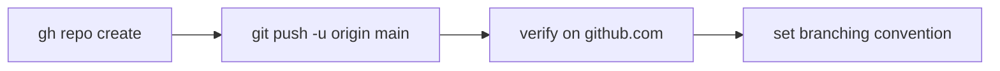

# Phase 1.3 — Publish to GitHub

## 🎯 Goal
Push your local `main` branch to a GitHub repository so there's a canonical remote, and establish the branching rule you'll follow for the rest of the project.

## 🧠 Concepts you'll meet
- **Local repo vs remote** — Git is distributed; GitHub is just one remote.
- **`origin`** — the conventional name for your primary remote.
- **Tracking branch** — a local branch that knows which remote branch it mirrors.
- **Branching convention** — one branch per feature, merged via a PR.

## 🤔 Why we're doing this now
A remote is cheap insurance against a dead laptop. It's also where PRs, Actions (CI), and public visibility live — the next phases assume it exists.

## 🗺 Flow



## ⌨️ Commands — you type these

### 1. Confirm you're authenticated

```bash
gh auth status
```

Must say `Logged in to github.com as <your-github-username>`. If not, re-run `gh auth login` (see Phase 0).

### 2. Create the remote repo and push in one shot

> **Note:** If you cloned this tutorial repo and want to keep working inside it, you already have a `summernote`-named GitHub repo (the one you're reading). In that case you can skip this step — Git already has `origin` set and your `main` is already tracking. Verify with `git remote -v`.

> If you're following this flow fresh (your own repo), run:

```bash
gh repo create SummerNote --public --source=. --remote=origin --description "Learning project: Django notes app with AI day-summarizer." --push
```

**Breakdown of each flag:**
- `--public` — world-readable (what you want for a portfolio). Use `--private` if you'd rather share only when polished.
- `--source=.` — "my current folder is the local repo."
- `--remote=origin` — add this GitHub repo as the `origin` remote.
- `--push` — immediately push your existing commits.

**Expected output includes:**
```
https://github.com/<your-github-username>/SummerNote
* [new branch]      HEAD -> main
branch 'main' set up to track 'origin/main'.
```

### 3. Verify the remote is wired

```bash
git remote -v
```

**Expected:**
```
origin  https://github.com/<your-github-username>/SummerNote.git (fetch)
origin  https://github.com/<your-github-username>/SummerNote.git (push)
```

### 4. Open the repo in a browser

```bash
gh repo view --web
```

You should see your `README.md` rendered, the `docs/` folder, and one commit in the history.

### 5. Learn the branching convention we'll use

From this point on, **never commit directly to `main`**. Each phase step gets its own branch:

```
feature/<step-id>-<short-slug>

examples:
feature/1.4-settings-env
feature/2.1-user-registration
feature/5.2-summarizer-service
```

You'll create a branch at the start of each phase step, commit your work there, push, open a PR, review your own diff, merge, delete the branch. We'll practice this starting in Phase 1.4.

**For now, you're still on `main`.** That's fine — Phase 1.1 through 1.3 are "setup" work.

## ✅ Validation — you've finished this phase when
- [ ] `git remote -v` shows an `origin` pointing at your GitHub repo
- [ ] `gh repo view --web` opens the repo in your browser
- [ ] The GitHub repo shows at least one commit in its history
- [ ] You can state (out loud, in your own words) the branching convention

## 🧪 Try breaking it (optional)
1. Open the GitHub page and look at the `README.md` preview. Try editing it in the GitHub web UI (**pencil icon**), save, then back in your terminal run `git pull`. You just synced a remote change into your local repo.
2. Make a tiny local change (add a line to `README.md`), run `git status`, `git add README.md`, `git commit -m "docs: tweak readme"`, `git push`. Reload the GitHub page. **This is the loop.**

## 📝 Reflect
- In your own words: what does "distributed" mean in "distributed version control"? Why does it matter if you commit while offline on a plane?
- Why do teams use feature branches instead of just committing to `main`? (Hint: review, revert, CI.)
- `origin` is a convention, not a Git keyword. What would happen if you named your remote `github` instead of `origin`?

## 🔗 Deeper reading
- GitHub CLI docs: https://cli.github.com/manual/gh_repo_create
- Git branches: https://git-scm.com/book/en/v2/Git-Branching-Branches-in-a-Nutshell

## ➡️ Next
`01-4-settings-env.md` — move Django's secrets out of code into a `.env` file (12-factor config). This is your **first feature branch**.
