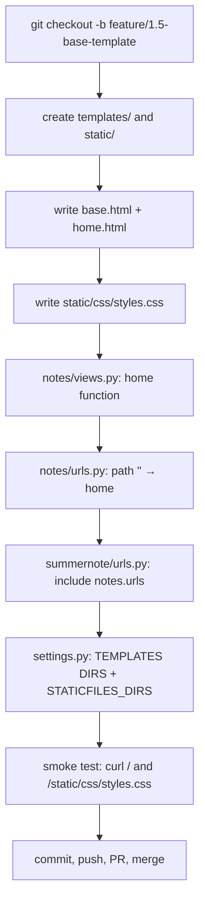
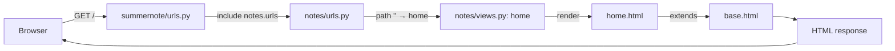

# Phase 1.5 — Base template + static files + first real view

## 🎯 Goal
Replace Django's default rocket page with a SummerNote home page. Introduce template inheritance, project-level static files, per-app URL routing, and your first view function.

## 🧠 Concepts you'll meet
- **MVT (Model-View-Template)** — Django's request cycle.
- **Template inheritance** — one base template + child templates that fill `` slots. The Template Method design pattern applied to markup.
- **Static files pipeline** — how `` resolves to the right URL.
- **URL namespacing per app** — each app owns its `urls.py`, included from the project.
- **View function** — a plain function that takes a `request` and returns an `HttpResponse`.

## 🤔 Why we're doing this now
Phase 1.4 proved the stack boots. This phase proves *you* can wire a URL to a view to a template to a static asset — the full request/response cycle. Every page the rest of the project renders is a variation of what you build here.

## 🗺 Flow



## 📊 Request flow you're wiring up



## ⌨️ Commands — you type these

### 1. Create a feature branch

```bash
git checkout -b feature/1.5-base-template
```

### 2. Create the folders

```bash
mkdir -p templates static/css
```

### 3. Create `templates/base.html`

Open a new file at `templates/base.html` and paste:

```html

<!doctype html>
<html lang="en">
<head>
    <meta charset="utf-8">
    <meta name="viewport" content="width=device-width, initial-scale=1">
    <title>SummerNote</title>
    <link rel="stylesheet" href="">
</head>
<body>
    <header class="site-header">
        <a class="brand" href="/">SummerNote</a>
        <nav class="site-nav">
            
        </nav>
    </header>

    <main class="site-main">
        
    </main>

    <footer class="site-footer">
        <small>SummerNote &middot; learning project</small>
    </footer>
</body>
</html>
```

**What's going on:**
- `` — makes the `` tag available.
- `` — a *slot* a child template can fill. Empty if the child doesn't override.
- `` — resolves to the correct URL for `static/css/styles.css` (in dev that's `/static/css/styles.css`; in prod it can be a hashed name on a CDN).

### 4. Create `templates/home.html`

```html


SummerNote &middot; Home


<section class="hero">
    <h1>Welcome to SummerNote</h1>
    <p class="lead">
        A simple notepad backed by a calendar &mdash; and an AI that can summarize your day
        from everything you wrote.
    </p>
    <p class="status">
        Scaffolding complete. Auth, notes, calendar, and the AI summarizer are coming next.
    </p>
</section>

```

**What's going on:**
- `` — "I'm a child of base.html; render me by inserting my blocks into its slots."
- Each `` here overrides the one in `base.html` with the same name.

### 5. Create `static/css/styles.css`

```css
:root {
    --bg: #faf7f2;
    --fg: #1b1b1b;
    --muted: #6b6b6b;
    --accent: #c2410c;
    --border: #e5e2dc;
    --max-width: 720px;
}

* { box-sizing: border-box; }

body {
    margin: 0;
    font-family: -apple-system, BlinkMacSystemFont, "Segoe UI", Helvetica, Arial, sans-serif;
    background: var(--bg);
    color: var(--fg);
    line-height: 1.5;
}

.site-header,
.site-main,
.site-footer {
    max-width: var(--max-width);
    margin: 0 auto;
    padding: 1rem 1.25rem;
}

.site-header {
    display: flex;
    align-items: center;
    justify-content: space-between;
    border-bottom: 1px solid var(--border);
}

.brand {
    font-weight: 700;
    font-size: 1.25rem;
    color: var(--accent);
    text-decoration: none;
}

.site-nav a {
    margin-left: 1rem;
    color: var(--muted);
    text-decoration: none;
}

.site-nav a:hover { color: var(--fg); }

.hero h1 {
    margin: 2rem 0 0.5rem;
    font-size: 2rem;
}

.lead {
    color: var(--muted);
    font-size: 1.1rem;
}

.status {
    margin-top: 2rem;
    padding: 0.75rem 1rem;
    background: #fff;
    border: 1px solid var(--border);
    border-radius: 6px;
    color: var(--muted);
    font-size: 0.95rem;
}

.site-footer {
    margin-top: 3rem;
    border-top: 1px solid var(--border);
    color: var(--muted);
}
```

### 6. Edit `notes/views.py`

Open it and replace the stub with:

```python
from django.shortcuts import render


def home(request):
    """Landing page. Will later redirect authed users to their calendar."""
    return render(request, "home.html")
```

**What's going on:**
- A view is just a function. Takes a `HttpRequest`, returns an `HttpResponse`.
- `render(request, template_name, context)` loads a template, substitutes variables from `context` (empty dict here), returns an `HttpResponse` with the result.

### 7. Create `notes/urls.py` (new file)

```python
from django.urls import path

from . import views

app_name = "notes"

urlpatterns = [
    path("", views.home, name="home"),
]
```

**What's going on:**
- `app_name = "notes"` creates a URL namespace. Later we can reverse-lookup `` without clashing with any other app's `home`.
- `path("", views.home, name="home")` — the empty path matches `/`.

### 8. Edit `summernote/urls.py`

Open it and replace with:

```python
from django.contrib import admin
from django.urls import include, path

urlpatterns = [
    path("admin/", admin.site.urls),
    path("", include("notes.urls")),
]
```

**What's going on:**
- `include("notes.urls")` — delegate all URLs that match this path prefix (empty = root) to the `notes` app's URL table.

### 9. Edit `summernote/settings.py` to tell Django about `templates/` and `static/`

Find `TEMPLATES = [...]` and change its `'DIRS'` entry from `[]` to:

```python
'DIRS': [BASE_DIR / 'templates'],
```

Find `STATIC_URL = 'static/'` and **add** right after it:

```python
STATIC_URL = 'static/'
STATICFILES_DIRS = [BASE_DIR / 'static']
# PROD TODO (Phase 6): set STATIC_ROOT and run `collectstatic`;
# serve via Whitenoise or Nginx.
```

### 10. Smoke test

```bash
python manage.py check
```
→ *0 issues.*

```bash
python manage.py runserver
```

Open http://127.0.0.1:8000/ in your browser. You should see:
- Title: `SummerNote · Home`
- Header with "SummerNote" brand
- "Welcome to SummerNote" hero
- Styled footer

Also test the static file loads:
```
http://127.0.0.1:8000/static/css/styles.css
```
→ CSS text should appear in the browser.

And test a 404:
```
http://127.0.0.1:8000/does-not-exist/
```
→ Yellow Django debug 404 page. Not an error — this is Django correctly telling you no route matches.

Stop the server with `Ctrl+C`.

### 11. Commit, push, PR, merge

```bash
git status
```
Confirm nothing sensitive is listed.

```bash
git add -A
git commit -m "feat(1.5): base template, home page, static files, first URL route"
git push -u origin feature/1.5-base-template
gh pr create --base main --head feature/1.5-base-template \
  --title "feat(1.5): base template + home page" \
  --body "Phase 1.5 — template inheritance, static files, first view, per-app URL routing."
```

Open the PR URL printed, self-review the diff, **Merge**, **Delete branch**.

Back in your terminal:
```bash
git checkout main && git pull --prune && git branch -d feature/1.5-base-template
```

## ✅ Validation — you've finished this phase when
- [ ] `python manage.py check` → *0 issues*
- [ ] `GET /` returns HTTP 200 and a page whose title contains "SummerNote"
- [ ] `GET /static/css/styles.css` returns HTTP 200 with your CSS
- [ ] `GET /does-not-exist/` returns a 404 page
- [ ] PR merged into `main` on GitHub
- [ ] Local `main` is up to date; feature branch deleted

## 🧪 Try breaking it (optional)
1. In `base.html` rename `` to ``. Reload `/`. Your home page content vanishes — because `home.html` is still filling a block named `content` that no longer exists. Rename back. **Lesson:** block names are the contract between parent and child.
2. In `home.html`, remove the `` line. Reload. You now see just your snippet, no header/footer/CSS. **Lesson:** `extends` is what makes inheritance happen.
3. Change `` to `/static/css/styles.css` (hardcoded). It still works in dev. **Then** imagine prod where static files are served from `https://cdn.example.com/abc123.styles.css` with a hashed filename — the `` tag would resolve to that automatically; the hardcoded version would be broken. **Lesson:** always use ``.
4. Rename `notes/urls.py` to `notes/routes.py` and update the `include()` accordingly. Does it still work? Why can `urls.py` be called anything, but `models.py`/`views.py`/`admin.py` can't?

## 📝 Reflect
- In your own words: describe the MVT cycle for a request to `/`. Trace it from the browser to the HTML and back.
- Why does Django need `settings.TEMPLATES['DIRS']` and `settings.STATICFILES_DIRS` in addition to looking inside apps? When would you prefer project-level dirs vs app-level?
- What's the difference between a `block` and an `include` in Django templates? When would you reach for each?

## 🔗 Deeper reading
- Templates: https://docs.djangoproject.com/en/5.2/topics/templates/
- Template inheritance: https://docs.djangoproject.com/en/5.2/ref/templates/language/#template-inheritance
- Static files: https://docs.djangoproject.com/en/5.2/howto/static-files/
- URL dispatcher: https://docs.djangoproject.com/en/5.2/topics/http/urls/

## ➡️ Next
**Phase 1 complete.** Next up: Phase 2.1 — User registration view + form. Coming soon.
