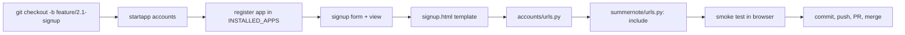
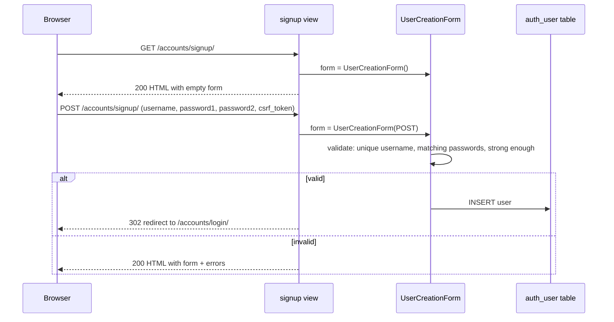

# Phase 2.1 — User registration (signup)

## 🎯 Goal
Create a new Django app called `accounts`, add a signup page where a visitor can register, and wire it to Django's built-in `UserCreationForm` so new rows land in the `auth_user` table.

## 🧠 Concepts you'll meet
- **Second Django app** — why we split auth from `notes`.
- **Django Form vs ModelForm vs UserCreationForm** — three levels of generality.
- **GET vs POST in a view** — the same URL serves the form (GET) and processes the submission (POST).
- **CSRF token** — why every HTML form in Django has `` and what it defends against.
- **`reverse()` and `reverse_lazy()`** — compute a URL from a view name instead of hardcoding `/accounts/login/`.

## 🤔 Why we're doing this now
Everything in the project assumes "the user" exists. Phase 3's `Note` will have `owner = ForeignKey(User)`; Phase 4's calendar will filter by `owner=request.user`. We need the ability to create a user *before* building anything that references one.

## 🗺 Flow



## 📊 Request flow for signup



## ⌨️ Commands — you type these

### 1. Create a feature branch

```bash
git checkout -b feature/2.1-signup
```

### 2. Create the `accounts` app

```bash
python manage.py startapp accounts
```

**Why a new app, not reuse `notes`?** Separation of concerns. `accounts` handles identity (signup/login/profile). `notes` handles the diary feature. If you later rip out notes to spin up a different app on the same auth, `accounts` goes with you cleanly.

### 3. Register `accounts` in `INSTALLED_APPS`

Open `summernote/settings.py`. In `INSTALLED_APPS`, add `'accounts'` next to `'notes'`:

```python
INSTALLED_APPS = [
    'django.contrib.admin',
    'django.contrib.auth',
    'django.contrib.contenttypes',
    'django.contrib.sessions',
    'django.contrib.messages',
    'django.contrib.staticfiles',
    # Local apps
    'notes',
    'accounts',
]
```

Verify:
```bash
python manage.py check
```
→ *0 issues*.

### 4. Write the signup form

Create `accounts/forms.py` (new file):

```python
from django.contrib.auth.forms import UserCreationForm
from django.contrib.auth.models import User


class SignupForm(UserCreationForm):
    class Meta(UserCreationForm.Meta):
        model = User
        fields = ("username", "email")
```

**What this does:**
- `UserCreationForm` is Django's built-in form that handles password hashing, matching-password validation, and username uniqueness.
- We subclass only to add `email` to the fields shown; defaults don't include it.

### 5. Write the signup view

Replace `accounts/views.py` with:

```python
from django.contrib.auth import login
from django.shortcuts import redirect, render
from django.urls import reverse

from .forms import SignupForm


def signup(request):
    """Register a new user. GET → empty form. POST → create + auto-login."""
    if request.method == "POST":
        form = SignupForm(request.POST)
        if form.is_valid():
            user = form.save()
            login(request, user)  # auto-login so UX is "signup → straight into app"
            return redirect(reverse("notes:home"))
        # fall through: re-render form with errors
    else:
        form = SignupForm()
    return render(request, "accounts/signup.html", {"form": form})
```

**Key ideas:**
- **One view, two methods.** `GET` builds an empty form; `POST` validates a submitted one. This is idiomatic Django.
- **`form.is_valid()`** returns `False` and populates `form.errors` if any field fails. Django re-renders the same template with error messages shown next to each field.
- **`login(request, user)`** attaches the user to the current session so they're logged in on the next request.
- **`redirect(reverse(...))`** — Post/Redirect/Get pattern: after a successful POST, send a 302 so refreshing the browser doesn't resubmit the form.

### 6. Write `accounts/urls.py` (new file)

```python
from django.urls import path

from . import views

app_name = "accounts"

urlpatterns = [
    path("signup/", views.signup, name="signup"),
]
```

### 7. Include it in the project `urls.py`

Edit `summernote/urls.py`:

```python
from django.contrib import admin
from django.urls import include, path

urlpatterns = [
    path("admin/", admin.site.urls),
    path("accounts/", include("accounts.urls")),
    path("", include("notes.urls")),
]
```

**Why `/accounts/` prefix?** It's a convention; Django's built-in `LoginView`/`LogoutView` (next phase) also live under `/accounts/`, so your URLs stay consistent.

### 8. Create the signup template

Create `templates/accounts/signup.html`:

```html


SummerNote &middot; Sign up


<section class="auth">
    <h1>Create your account</h1>
    <form method="post" novalidate>
        
        {{ form.as_p }}
        <button type="submit">Sign up</button>
    </form>
    <p class="muted">
        Already have an account? <a href="">Log in</a>.
        <br><small>(The login link will 404 until Phase 2.2 — that's expected.)</small>
    </p>
</section>

```

**What's going on:**
- `` — Django requires this on every `POST` form. It injects a hidden `<input>` with a per-session token; a missing/mismatched token → 403 Forbidden. Defends against **CSRF (cross-site request forgery)** attacks where a malicious site tricks your browser into POSTing to this app.
- `{{ form.as_p }}` — render each field wrapped in a `<p>`. Minimal styling; good enough for Phase 2. Later you can render fields individually for custom layout.

Add a bit of CSS to `static/css/styles.css` (append at the bottom):

```css
.auth {
    max-width: 420px;
    margin: 2rem auto;
}

.auth form p {
    margin-bottom: 1rem;
}

.auth input {
    width: 100%;
    padding: 0.5rem;
    border: 1px solid var(--border);
    border-radius: 4px;
    font-size: 1rem;
}

.auth button {
    padding: 0.6rem 1.2rem;
    background: var(--accent);
    color: white;
    border: none;
    border-radius: 4px;
    cursor: pointer;
    font-size: 1rem;
}

.auth button:hover { opacity: 0.9; }

.auth .errorlist {
    color: #b91c1c;
    list-style: none;
    padding: 0;
    margin: 0 0 0.5rem;
    font-size: 0.9rem;
}

.muted {
    color: var(--muted);
    font-size: 0.95rem;
}
```

### 9. Smoke test

```bash
python manage.py check
python manage.py runserver
```

Open http://127.0.0.1:8000/accounts/signup/ in your browser.

**Try the happy path:**
- Username: `alice`
- Email: `alice@example.com`
- Password + confirm: pick something at least 8 chars and not entirely numeric.
- Click **Sign up**.
- Expected: you're redirected to `/` (home) and *logged in* (even though home doesn't show a logged-in indicator yet — we'll add that in Phase 2.2).

**Try the unhappy paths:**
- Submit with blank fields → see per-field error messages.
- Submit with password `12345678` → see "This password is entirely numeric" or similar.
- Submit again with username `alice` → see "A user with that username already exists."

**Verify a user actually landed in the DB:**

```bash
python manage.py shell -c "from django.contrib.auth.models import User; print(list(User.objects.values_list('username','email')))"
```

→ `[('alice', 'alice@example.com')]`

Stop the server (`Ctrl+C`).

### 10. Commit, push, PR, merge

```bash
git status
```
Verify only intended changes are listed. Nothing in `db.sqlite3` or `.env` should appear.

```bash
git add -A
git commit -m "feat(2.1): accounts app with signup view and form"
git push -u origin feature/2.1-signup
gh pr create --base main --head feature/2.1-signup \
  --title "feat(2.1): signup" \
  --body "Phase 2.1 — accounts app, SignupForm (UserCreationForm + email), signup view with POST/redirect/GET pattern, auto-login after signup, signup.html template."
```

Self-review on GitHub → **Merge** → **Delete branch**.

```bash
git checkout main && git pull --prune && git branch -d feature/2.1-signup
```

## ✅ Validation — you've finished this phase when
- [ ] `accounts/` app exists and is in `INSTALLED_APPS`
- [ ] `GET /accounts/signup/` → form page (200)
- [ ] `POST /accounts/signup/` with valid data → redirect to `/` (302)
- [ ] A new row appears in `auth_user` after a successful signup
- [ ] Submitting invalid data re-renders the form with error messages
- [ ] PR merged, feature branch deleted

## 🧪 Try breaking it (optional)
1. Delete `` from the template. Submit the form. You'll get a **403 Forbidden** with "CSRF verification failed." Put it back. **Lesson:** CSRF protection is on by default and is non-negotiable for state-changing forms.
2. In `signup()`, remove the `if form.is_valid():` guard and call `form.save()` unconditionally. Submit the form with bad data. You'll get a traceback (`ValueError: The User could not be created because the data didn't validate.`). Put the guard back. **Lesson:** validation and persistence are two separate steps for a reason.
3. Change `return redirect(reverse("notes:home"))` to `return redirect("/")` (hardcoded path). It still works today. Imagine later renaming the URL — the hardcoded version breaks silently. **Lesson:** always reverse by name.
4. Open `django.contrib.auth.password_validation` in the Django source (or docs) and read what's enforced by default: minimum length, common-password check, numeric-password check, user-attribute similarity. These were already protecting your signup — `UserCreationForm` wires them for you.

## 📝 Reflect
- In your own words: what is CSRF, and why is it a problem that cookies-based auth is otherwise fine for?
- Why does the signup view handle both `GET` and `POST` at the same URL instead of two separate URLs?
- `UserCreationForm` is a `ModelForm`. In your own words, what does a `ModelForm` save you from writing by hand?

## 🔗 Deeper reading
- Forms overview: https://docs.djangoproject.com/en/5.2/topics/forms/
- `UserCreationForm` source: https://github.com/django/django/blob/main/django/contrib/auth/forms.py
- CSRF explained: https://docs.djangoproject.com/en/5.2/ref/csrf/

## ➡️ Next
`02-2-login-logout.md` — Django's built-in `LoginView` and `LogoutView`, templates, and session cookies.
