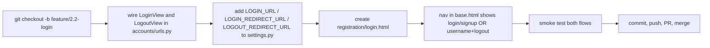

# Phase 2.2 — Login & logout

## 🎯 Goal
Reuse Django's built-in `LoginView` and `LogoutView` to let users sign in and out. Add a navbar that shows the current user's name when logged in and the right action link based on auth state.

## 🧠 Concepts you'll meet
- **Class-based views (CBVs)** — Django ships many ready-to-use ones for auth. Why they exist alongside function views.
- **Session cookies** — how Django remembers you're logged in across requests.
- **`LOGIN_URL`, `LOGIN_REDIRECT_URL`, `LOGOUT_REDIRECT_URL`** — three settings that control auth redirects.
- **`request.user`** and **`user.is_authenticated`** — the universal "who is this?" check.
- **Template conditionals** — `` in the navbar.

## 🤔 Why we're doing this now
Phase 2.1 can create users; now they need to be able to come back later. Login/logout also gives us the *authentication signal* that every later feature (notes, calendar, summarize) will depend on.

## 🗺 Flow



## 📊 Session cookie lifecycle

```mermaid
sequenceDiagram
    participant B as Browser
    participant V as LoginView
    participant S as session store (DB)
    B->>V: POST /accounts/login/ (username, password)
    V->>V: authenticate(username, password)
    V->>S: create session row, generate sessionid
    V-->>B: 302 to LOGIN_REDIRECT_URL, Set-Cookie: sessionid=abc...
    Note over B: Browser stores cookie; sends it with every request to this domain
    B->>V: GET /notes/ (Cookie: sessionid=abc...)
    V->>S: look up session by sessionid → user_id
    V-->>B: 200 (user is request.user)
    B->>V: POST /accounts/logout/
    V->>S: delete session row
    V-->>B: 302, Set-Cookie clearing sessionid
```

## ⌨️ Commands — you type these

### 1. Create a feature branch

```bash
git checkout -b feature/2.2-login
```

### 2. Wire Django's built-in auth views into `accounts/urls.py`

Edit `accounts/urls.py`:

```python
from django.contrib.auth import views as auth_views
from django.urls import path

from . import views

app_name = "accounts"

urlpatterns = [
    path("signup/", views.signup, name="signup"),
    path(
        "login/",
        auth_views.LoginView.as_view(template_name="registration/login.html"),
        name="login",
    ),
    path(
        "logout/",
        auth_views.LogoutView.as_view(),
        name="logout",
    ),
]
```

**What's going on:**
- `LoginView` and `LogoutView` are **class-based views** built into Django. They implement the standard login/logout flow — form rendering, authentication, session creation, redirecting — out of the box.
- `.as_view(...)` turns a class into a callable Django's URL dispatcher can route to.
- `template_name="registration/login.html"` tells `LoginView` where its template lives. Django looks in each app's `templates/` folder *and* in our project-level `templates/` dir.

### 3. Add auth-redirect settings

Open `summernote/settings.py`. At the bottom (anywhere, but keeping like with like helps), add:

```python
# Authentication redirects
LOGIN_URL = "accounts:login"            # where @login_required sends anonymous users
LOGIN_REDIRECT_URL = "notes:home"       # where LoginView sends you after success
LOGOUT_REDIRECT_URL = "notes:home"      # where LogoutView sends you after logout
```

**What each one controls:**
- `LOGIN_URL` — when a `@login_required` view rejects an anonymous user, Django redirects them *here*. We'll use this in Phase 2.6.
- `LOGIN_REDIRECT_URL` — default landing after a successful login (overridable per-request via `?next=/some/path/`).
- `LOGOUT_REDIRECT_URL` — where to send the browser after logout. Without this, Django renders a boring default "logged out" page.

### 4. Create the login template

Create `templates/registration/login.html`:

```html


SummerNote &middot; Log in


<section class="auth">
    <h1>Log in</h1>
    <form method="post" novalidate>
        
        {{ form.as_p }}
        <button type="submit">Log in</button>
    </form>
    <p class="muted">
        No account? <a href="">Sign up</a>.
    </p>
</section>

```

**Note the folder name `registration/`** — this is a Django convention; the built-in `LoginView` looks for `registration/login.html` by default. We overrode it explicitly in step 2 for clarity.

### 5. Update the navbar in `templates/base.html`

Find the `` line in `base.html` and replace with:

```html
<nav class="site-nav">
    
        <span class="muted">Hi, {{ user.username }}</span>
        <form method="post" action="" class="inline-form">
            
            <button type="submit" class="link-button">Log out</button>
        </form>
    
        <a href="">Log in</a>
        <a href="">Sign up</a>
    
</nav>
```

**Why is logout a `<form>` and not a link?** As of Django 5, `LogoutView` only accepts `POST` for safety — a bare `<a href>` would be a `GET`, which it refuses. GET-based logout is a classic CSRF foot-gun (a malicious page could embed `` and log you out silently).

Append CSS so the inline form looks right. Add to `static/css/styles.css`:

```css
.inline-form {
    display: inline;
}

.link-button {
    background: none;
    border: none;
    color: var(--muted);
    cursor: pointer;
    font: inherit;
    padding: 0;
    margin-left: 1rem;
}

.link-button:hover { color: var(--fg); }
```

### 6. Smoke test — all three flows

```bash
python manage.py check
python manage.py runserver
```

**Flow A — logged-out home page:**
- Open http://127.0.0.1:8000/
- Nav shows: `Log in · Sign up`

**Flow B — log in:**
- Click **Log in**
- Enter the `alice` credentials from Phase 2.1
- You land on `/` (home). Nav now shows: `Hi, alice · Log out`

**Flow C — log out:**
- Click **Log out** in the nav
- Back on `/`, nav shows: `Log in · Sign up` again

**Flow D — bad password:**
- Log out if logged in
- Go to `/accounts/login/`
- Enter wrong password
- Form re-renders with "Please enter a correct username and password."

**Verify the session cookie exists in your browser:**
- While logged in, open browser DevTools → Application → Cookies → `127.0.0.1`
- You'll see `sessionid` with a long random value. That's your identity for the next request.

### 7. Commit, push, PR, merge

```bash
git status
git add -A
git commit -m "feat(2.2): login & logout via auth_views; nav shows auth state"
git push -u origin feature/2.2-login
gh pr create --base main --head feature/2.2-login \
  --title "feat(2.2): login + logout" \
  --body "Phase 2.2 — LoginView and LogoutView wired; LOGIN_URL / LOGIN_REDIRECT_URL / LOGOUT_REDIRECT_URL set; login.html template; nav conditionally shows auth state."
```

Self-review → **Merge** → **Delete branch** → sync local main.

```bash
git checkout main && git pull --prune && git branch -d feature/2.2-login
```

## ✅ Validation — you've finished this phase when
- [ ] `GET /accounts/login/` returns a styled login form
- [ ] `POST /accounts/login/` with correct credentials → 302 to `/`
- [ ] `POST /accounts/login/` with wrong credentials → form re-renders with an error
- [ ] After login, the home page nav shows `Hi, <username>` + Log out
- [ ] Clicking Log out → nav flips back to Log in / Sign up
- [ ] A `sessionid` cookie exists in your browser while logged in

## 🧪 Try breaking it (optional)
1. Change the logout `<form>` to an `<a href="">`. Click it. **405 Method Not Allowed.** Change back. **Lesson:** Django 5 refuses `GET` logout by design.
2. Comment out `LOGIN_REDIRECT_URL` in settings and log in again. You'll land on `/accounts/profile/` (Django's hard-coded default) and see a 404. **Lesson:** without explicit redirect settings, Django falls back to defaults you probably don't want.
3. Delete your session cookie in DevTools and refresh the home page. Nav flips to "Log in / Sign up" even though you didn't logout. **Lesson:** the cookie IS your authentication; losing it is identical to logging out.
4. Open the SQLite database: `python manage.py dbshell` then `SELECT session_key, expire_date FROM django_session;` → You'll see your current session row. `.quit` to exit. **Lesson:** sessions are rows in a table, not magic.

## 📝 Reflect
- In your own words: what's actually stored *in* the session cookie, and what's stored on the server?
- Why is logout a `POST` and not a `GET`? Give one concrete attack a `GET` logout would enable.
- The nav uses ``. Where does `user` come from inside a template?

## 🔗 Deeper reading
- Django auth overview: https://docs.djangoproject.com/en/5.2/topics/auth/default/
- `LoginView` and `LogoutView`: https://docs.djangoproject.com/en/5.2/topics/auth/default/#module-django.contrib.auth.views
- Session docs: https://docs.djangoproject.com/en/5.2/topics/http/sessions/

## ➡️ Next
`02-3-password-reset.md` — the four-view password reset flow (request → email → confirm → done).
