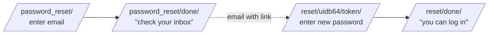

# Phase 2.3 — Password reset flow

## 🎯 Goal
Wire Django's built-in four-view password-reset flow and configure a dev email backend that prints emails to your terminal (so you can read the reset link without needing a real SMTP server).

## 🧠 Concepts you'll meet
- **Signed, time-limited tokens** — the reset link is a signed URL that becomes a one-time credential.
- **Four-view flow** — a complete UX made of four small CBVs chained by redirects and emails.
- **Email backends in Django** — `console`, `file`, `smtp`, `locmem` — swapped by one setting.
- **Why self-service password reset is a security-sensitive feature** — enumeration attacks and how Django mitigates them.

## 🤔 Why we're doing this now
Users forget passwords. Without reset, your only option is to delete and recreate their account — unusable in reality. Wiring reset also teaches you the pattern for signed URLs, which comes back in Phase 5 (idempotency keys) and anywhere you need "unguessable but verifiable" tokens.

## 🗺 The four-view flow



Four URLs, four templates, two emails (HTML + subject). Django ships all four views; we just route them and provide templates.

## ⌨️ Commands — you type these

### 1. Feature branch

```bash
git checkout -b feature/2.3-password-reset
```

### 2. Configure a dev email backend

Open `summernote/settings.py` and add (near the auth-redirect settings is a good spot):

```python
# Email backend — dev prints to terminal; prod would use SMTP.
EMAIL_BACKEND = "django.core.mail.backends.console.EmailBackend"
DEFAULT_FROM_EMAIL = "SummerNote <no-reply@summernote.local>"
```

**What this does:** instead of actually sending email, Django prints each message to the terminal where `runserver` runs. Zero SMTP config required.

**For prod later:** swap the backend to `django.core.mail.backends.smtp.EmailBackend` and add `EMAIL_HOST`, `EMAIL_PORT`, `EMAIL_HOST_USER`, `EMAIL_HOST_PASSWORD`, `EMAIL_USE_TLS`.

### 3. Wire the four URLs

Edit `accounts/urls.py`:

```python
from django.contrib.auth import views as auth_views
from django.urls import path, reverse_lazy

from . import views

app_name = "accounts"

urlpatterns = [
    path("signup/", views.signup, name="signup"),
    path(
        "login/",
        auth_views.LoginView.as_view(template_name="registration/login.html"),
        name="login",
    ),
    path(
        "logout/",
        auth_views.LogoutView.as_view(),
        name="logout",
    ),

    # Password reset — four steps:
    path(
        "password_reset/",
        auth_views.PasswordResetView.as_view(
            template_name="registration/password_reset_form.html",
            email_template_name="registration/password_reset_email.html",
            subject_template_name="registration/password_reset_subject.txt",
            success_url=reverse_lazy("accounts:password_reset_done"),
        ),
        name="password_reset",
    ),
    path(
        "password_reset/done/",
        auth_views.PasswordResetDoneView.as_view(
            template_name="registration/password_reset_done.html",
        ),
        name="password_reset_done",
    ),
    path(
        "reset/<uidb64>/<token>/",
        auth_views.PasswordResetConfirmView.as_view(
            template_name="registration/password_reset_confirm.html",
            success_url=reverse_lazy("accounts:password_reset_complete"),
        ),
        name="password_reset_confirm",
    ),
    path(
        "reset/done/",
        auth_views.PasswordResetCompleteView.as_view(
            template_name="registration/password_reset_complete.html",
        ),
        name="password_reset_complete",
    ),
]
```

**Why `reverse_lazy()` instead of `reverse()`?** URL resolution happens *before* `urlpatterns` is fully loaded when a class attribute is evaluated at import time. `reverse_lazy` defers the lookup until the URL is actually needed. Use `reverse()` inside views; `reverse_lazy()` for class attributes and settings.

**What the `<uidb64>` and `<token>` segments are:** base64-encoded user ID + a signed, time-limited HMAC token. Django verifies both before allowing a password change. The token invalidates automatically after use or after the configured timeout (default 3 days).

### 4. Create the four templates

Create `templates/registration/password_reset_form.html`:

```html

Reset password

<section class="auth">
    <h1>Reset your password</h1>
    <p class="muted">Enter the email you signed up with. We'll send you a reset link.</p>
    <form method="post" novalidate>
        
        {{ form.as_p }}
        <button type="submit">Send reset link</button>
    </form>
</section>

```

Create `templates/registration/password_reset_done.html`:

```html

Check your email

<section class="auth">
    <h1>Check your email</h1>
    <p>If an account exists for the address you entered, we've sent instructions to reset your password.</p>
    <p class="muted"><small>Note: in dev, the email is printed to your terminal.</small></p>
</section>

```

**Important:** notice the phrasing *"if an account exists"*. We **don't** say "we've sent email to X" or "no account found" — that would let an attacker check whether an email is registered (**user enumeration**). Django's default template is written exactly this way; copy that discipline.

Create `templates/registration/password_reset_email.html`:

```
Hi,

You asked to reset your SummerNote password. Click the link below to set a new one:

{{ protocol }}://{{ domain }}

If you didn't request this, ignore this message — nothing will change.

— SummerNote
```

Create `templates/registration/password_reset_subject.txt` (single line, no blank final line):

```
SummerNote password reset
```

Create `templates/registration/password_reset_confirm.html`:

```html

Set a new password

<section class="auth">
    
        <h1>Set a new password</h1>
        <form method="post" novalidate>
            
            {{ form.as_p }}
            <button type="submit">Save new password</button>
        </form>
    
        <h1>Link invalid or expired</h1>
        <p>Please <a href="">request a new reset link</a>.</p>
    
</section>

```

**`validlink`** is a context variable Django's view sets to `True`/`False` based on whether the token verified. We branch on it.

Create `templates/registration/password_reset_complete.html`:

```html

Password reset

<section class="auth">
    <h1>Password reset</h1>
    <p>Your password has been updated. <a href="">Log in</a>.</p>
</section>

```

### 5. Link to it from the login page

Edit `templates/registration/login.html`. Add before the closing `</section>`:

```html
<p class="muted"><a href="">Forgot your password?</a></p>
```

### 6. Smoke test the full flow

```bash
python manage.py check
python manage.py runserver
```

**Walk through it:**
1. Visit `/accounts/login/` → click "Forgot your password?"
2. Enter the email you signed up with in Phase 2.1 (e.g. `alice@example.com`). Click **Send reset link**.
3. See the "check your email" page.
4. **Switch to the terminal running `runserver`** — you'll see the email body printed, including a URL like `http://127.0.0.1:8000/accounts/reset/MQ/abcd-...xyz/`.
5. Copy that URL into your browser.
6. Set a new password and submit.
7. Land on the "Password reset" complete page. Click **Log in** and verify the new password works.

### 7. Try the security edge cases
- Enter an email that doesn't exist on the reset form → still see the "check your email" page (no enumeration leak). No email is sent.
- Try to reuse the same reset link a second time → `validlink` is `False`, you see "Link invalid or expired."
- Change one character in the token in the URL → same thing: `validlink=False`.

### 8. Commit, push, PR, merge

```bash
git status
git add -A
git commit -m "feat(2.3): password reset (4-view flow) with console email backend"
git push -u origin feature/2.3-password-reset
gh pr create --base main --head feature/2.3-password-reset \
  --title "feat(2.3): password reset flow" \
  --body "Phase 2.3 — PasswordResetView, PasswordResetDoneView, PasswordResetConfirmView, PasswordResetCompleteView wired. Console email backend for dev. Templates written to avoid user-enumeration leaks."
```

Merge, delete branch, sync local main.

## ✅ Validation — you've finished this phase when
- [ ] `GET /accounts/password_reset/` → form page
- [ ] Submitting with a known email → terminal shows an email with a reset link
- [ ] Submitting with an unknown email → same "check your email" page, no email sent
- [ ] Visiting the reset link → "set a new password" form
- [ ] Submitting new password → "password reset" complete page
- [ ] Reusing the same reset link → "link invalid or expired"
- [ ] You can log in with the new password

## 🧪 Try breaking it (optional)
1. In `settings.py`, change `EMAIL_BACKEND` to `"django.core.mail.backends.dummy.EmailBackend"`. Request a reset. The flow still "works" (no error), but nothing prints anywhere — emails are silently dropped. Revert. **Lesson:** backends are plugs; the app code doesn't know or care.
2. Wait > 3 days to use a reset link... or temporarily set `PASSWORD_RESET_TIMEOUT = 10` in settings (10 seconds) and try the full flow with a deliberate pause. The link expires. Revert the setting.
3. Open the signed token: `python manage.py shell` then:
   ```python
   from django.contrib.auth.tokens import default_token_generator
   from django.contrib.auth.models import User
   u = User.objects.get(username="alice")
   t = default_token_generator.make_token(u)
   print(t)
   print(default_token_generator.check_token(u, t))      # True
   u.set_unusable_password(); u.save()                   # imagine another reset was consumed
   print(default_token_generator.check_token(u, t))      # False — invalidated
   ```
   **Lesson:** the token mixes in the user's current password hash and `last_login`, so any auth-state change invalidates all outstanding tokens.

## 📝 Reflect
- In your own words: why does Django show the same "check your email" page regardless of whether the email exists?
- Why is the reset token tied to the user's current password hash?
- `EMAIL_BACKEND = "...console.EmailBackend"` is a one-line swap for dev. Describe (don't code) what it would take to use Gmail SMTP in prod and what secrets you'd need in `.env`.

## 🔗 Deeper reading
- Password reset views: https://docs.djangoproject.com/en/5.2/topics/auth/default/#django.contrib.auth.views.PasswordResetView
- Signing docs: https://docs.djangoproject.com/en/5.2/topics/signing/
- Sending email: https://docs.djangoproject.com/en/5.2/topics/email/

## ➡️ Next
`02-4-profile-model.md` — the `Profile` model (one-to-one with User) + a signal to create one automatically on signup.
