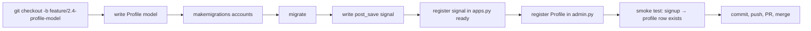
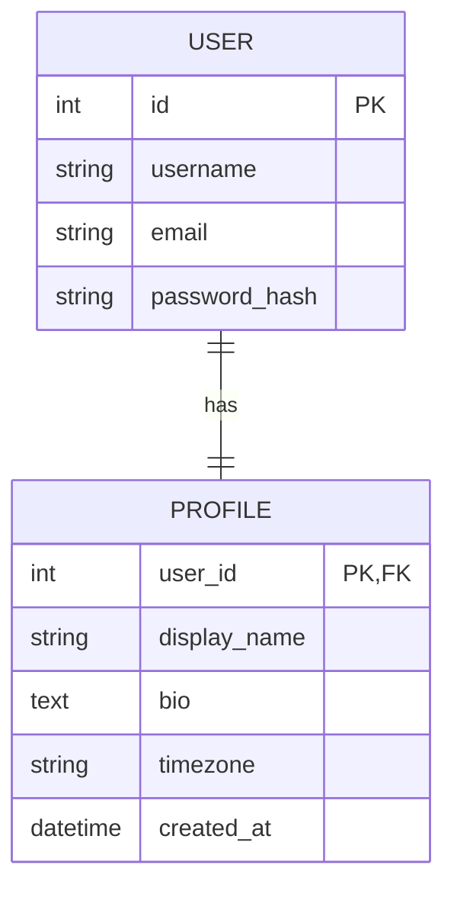

# Phase 2.4 — The Profile model

## 🎯 Goal
Add a `Profile` model (one-to-one with `User`) carrying display name, bio, and timezone. Auto-create a profile row every time a new user signs up — using Django's **signals**.

## 🧠 Concepts you'll meet
- **`OneToOneField`** — a `ForeignKey` with a unique constraint; the ORM-level "has-a" relationship.
- **Migrations** — the file-based record of every schema change; `makemigrations` writes, `migrate` applies.
- **Signals** (`post_save`) — the pub/sub mechanism Django uses to hook into model lifecycle events.
- **The signal vs override-save debate** — two ways to react to object creation.
- **Timezone-aware storage** — storing timezone identifiers (`"America/Chicago"`) rather than offsets.
- **Django admin** — the free CRUD UI for your models.

## 🤔 Why we're doing this now
`User` is Django's built-in model and we **should not** modify it directly (migrations get painful; libraries assume stock `User`). The clean extension pattern is a sidecar one-to-one model. We need a Profile before Phase 2.5 (profile view/edit) and before Phase 4 (which uses the user's timezone to render the calendar correctly).

## 🗺 Flow



## 📊 Model relationship



## ⌨️ Commands — you type these

### 1. Feature branch

```bash
git checkout -b feature/2.4-profile-model
```

### 2. Write the `Profile` model

Replace `accounts/models.py` with:

```python
from django.conf import settings
from django.db import models


class Profile(models.Model):
    user = models.OneToOneField(
        settings.AUTH_USER_MODEL,
        on_delete=models.CASCADE,
        related_name="profile",
    )
    display_name = models.CharField(max_length=80, blank=True)
    bio = models.TextField(blank=True)
    # IANA timezone id, e.g. "America/Chicago". Default UTC until user picks one.
    timezone = models.CharField(max_length=64, default="UTC")
    created_at = models.DateTimeField(auto_now_add=True)

    def __str__(self):
        return f"Profile<{self.user.username}>"
```

**Key decisions:**
- **`settings.AUTH_USER_MODEL`** instead of importing `User` directly. If you ever swap to a custom user model, this still works. Standard Django hygiene.
- **`on_delete=CASCADE`** — if the user is deleted, their profile goes too. There's no orphan profile.
- **`related_name="profile"`** — enables `user.profile` as the reverse accessor. Without this it would be `user.profile_set` (plural, confusing for one-to-one).
- **`blank=True`** means "the form allows empty"; **`null=True`** means "the DB allows NULL." We use `blank=True` for text fields and let empty string be the default — simpler than `NULL vs ""` ambiguity.
- **`timezone` as a `CharField`** holding an IANA zone id (`"America/Chicago"`). Later we'll validate it against `zoneinfo` zones. We'll use this in Phase 4 to render the calendar in the user's local time.
- **`auto_now_add=True`** — set once at creation; never updated.

### 3. Create and apply the migration

```bash
python manage.py makemigrations accounts
```

**Expected output:**
```
Migrations for 'accounts':
  accounts/migrations/0001_initial.py
    + Create model Profile
```

Look at the file Django wrote — it's just Python:
```bash
cat accounts/migrations/0001_initial.py
```

**This file goes into Git.** It's the authoritative, replayable record of your schema. Teammates, CI, and prod all `migrate` from these files; nobody edits the DB by hand.

Apply the migration:
```bash
python manage.py migrate
```

**Expected output includes:**
```
Applying accounts.0001_initial... OK
```

### 4. Auto-create a profile on signup — via signal

Create `accounts/signals.py` (new file):

```python
from django.conf import settings
from django.db.models.signals import post_save
from django.dispatch import receiver

from .models import Profile


@receiver(post_save, sender=settings.AUTH_USER_MODEL)
def create_profile_for_new_user(sender, instance, created, **kwargs):
    """Every new User gets exactly one Profile row."""
    if created:
        Profile.objects.create(user=instance)
```

**What this does:**
- `post_save` is a signal Django emits after any model's `save()`.
- `@receiver` connects our function to the signal, filtered to the User model.
- `created` is `True` only on INSERT, not UPDATE — so we don't create duplicate profiles when a user is edited.

### 5. Register the signal when the app starts

Signals won't fire until the file they live in is *imported*. The convention is to import them in the app's `AppConfig.ready()`.

Open `accounts/apps.py` and replace with:

```python
from django.apps import AppConfig


class AccountsConfig(AppConfig):
    default_auto_field = "django.db.models.BigAutoField"
    name = "accounts"

    def ready(self):
        from . import signals  # noqa: F401  (imported for its side effects)
```

**Why `# noqa: F401`?** Linters flag the unused import. We tell them *we know, it's deliberate* — the import's purpose is to run the `@receiver` decoration.

### 6. Register `Profile` in Django admin

Open `accounts/admin.py` and replace with:

```python
from django.contrib import admin

from .models import Profile


@admin.register(Profile)
class ProfileAdmin(admin.ModelAdmin):
    list_display = ("user", "display_name", "timezone", "created_at")
    search_fields = ("user__username", "display_name")
    list_filter = ("timezone",)
```

**What this does:** adds a `/admin/accounts/profile/` page to Django's auto-generated admin UI with a list, filters, and search. **Zero HTML written.**

To use the admin, you need a superuser:
```bash
python manage.py createsuperuser
```
Pick a username, email (optional), password. **Don't commit these credentials.**

### 7. Smoke test the signal

```bash
python manage.py check
python manage.py runserver
```

**Create a brand-new user through signup** at `/accounts/signup/` (e.g. `bob`). Then verify a Profile row was created:

```bash
python manage.py shell -c "from django.contrib.auth.models import User; u=User.objects.get(username='bob'); print(u.profile.id, u.profile.timezone, u.profile.display_name)"
```

**Expected:** something like `2 UTC `. If you get `User has no profile`, the signal didn't fire — check that `AccountsConfig.ready()` imports `signals`.

**Verify Alice (created in Phase 2.1 before the signal existed) does NOT have a profile:**

```bash
python manage.py shell -c "from django.contrib.auth.models import User; u=User.objects.get(username='alice'); print(getattr(u,'profile',None))"
```

**Expected:** `None` (or `RelatedObjectDoesNotExist` — try/except it in the shell). Fix with a one-time backfill:

```bash
python manage.py shell -c "from django.contrib.auth.models import User; from accounts.models import Profile; [Profile.objects.get_or_create(user=u) for u in User.objects.filter(profile__isnull=True)]"
```

**Lesson:** signals only affect *future* saves. Backfills exist precisely because of this. In a real deploy, a data migration (`python manage.py makemigrations --empty accounts`) would do this instead of a shell one-liner.

### 8. Explore the admin

Visit http://127.0.0.1:8000/admin/ → log in as your superuser → click **Profiles**. You'll see rows for every user with a profile. Edit one by hand (set a `display_name`, change `timezone` to `America/Chicago`), save, done.

### 9. Commit, push, PR, merge

```bash
git status
git add -A
git commit -m "feat(2.4): Profile model + post_save signal + admin"
git push -u origin feature/2.4-profile-model
gh pr create --base main --head feature/2.4-profile-model \
  --title "feat(2.4): Profile model" \
  --body "Phase 2.4 — Profile sidecar model (OneToOne with User), post_save signal creates one on signup, registered in Django admin. Migration 0001_initial for accounts."
```

Merge, delete branch, sync local main.

## ✅ Validation — you've finished this phase when
- [ ] `accounts/migrations/0001_initial.py` exists and is committed
- [ ] `python manage.py migrate` shows the migration applied
- [ ] Creating a new user via signup auto-creates a `Profile` row
- [ ] The Django admin at `/admin/accounts/profile/` lists profile rows
- [ ] Old users (pre-signal) got backfilled with profiles

## 🧪 Try breaking it (optional)
1. Comment out the `from . import signals` line in `apps.py`. Restart `runserver`. Sign up a new user. `u.profile` now raises `RelatedObjectDoesNotExist`. Uncomment. **Lesson:** signals don't register themselves.
2. Change `on_delete=models.CASCADE` to `on_delete=models.PROTECT`, run `makemigrations`. Then try to delete a user from admin → DB-level error. Revert the migration (`git checkout` the migration file, `migrate accounts 0001`). **Lesson:** `on_delete` is a real decision, not a boilerplate.
3. In `Profile.__str__`, raise an exception on purpose. Visit the admin list page — it still renders but admin shows errors. **Lesson:** `__str__` is called everywhere; keep it fast and side-effect-free.
4. Add a second field to `Profile` (e.g. `pronouns = models.CharField(max_length=40, blank=True)`). Run `makemigrations accounts`. Look at the generated `0002_*.py`. **Each migration is a diff from the previous schema** — this is why we never edit old migrations after they ship.

## 📝 Reflect
- In your own words: why do we extend `User` with a sidecar `Profile` instead of adding fields to `User` directly?
- When is a signal the right tool, and when would you instead put the logic in a service / form `save()` method?
- A migration file is just Python. What would happen if two devs each add a migration on different branches and then merge? (Hint: migration conflict → `makemigrations --merge`.)

## 🔗 Deeper reading
- Model fields reference: https://docs.djangoproject.com/en/5.2/ref/models/fields/
- Migrations: https://docs.djangoproject.com/en/5.2/topics/migrations/
- Signals: https://docs.djangoproject.com/en/5.2/topics/signals/
- Django admin: https://docs.djangoproject.com/en/5.2/ref/contrib/admin/

## ➡️ Next
`02-5-profile-view.md` — a view + form so users can see and edit their own profile.
