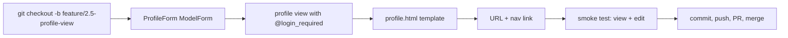
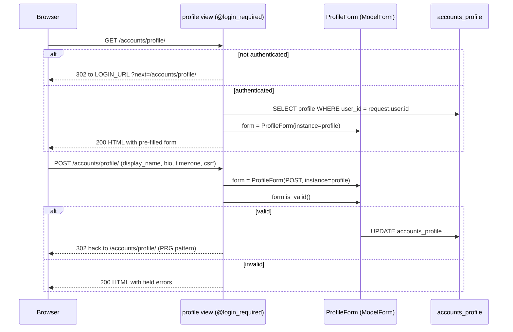

# Phase 2.5 — Profile view + edit page

## 🎯 Goal
Give the logged-in user a page at `/accounts/profile/` where they can view and edit their own `Profile` (display name, bio, timezone).

## 🧠 Concepts you'll meet
- **`@login_required`** — the decorator that enforces authentication on a view.
- **`ModelForm`** — a form Django generates from a model class (zero manual fields).
- **Timezone choices** — using `zoneinfo` to get the IANA zone list.
- **Service layer vs view** — where business logic goes.
- **Reverse-URL namespacing** — `` not `/accounts/profile/`.

## 🤔 Why we're doing this now
Phase 2.4 built the DB-side plumbing. Users still can't see or change their profile. This step closes the loop, and sets up the **timezone** value Phase 4's calendar will need.

## 🗺 Flow



## 📊 Request flow for profile edit



## ⌨️ Commands — you type these

### 1. Feature branch

```bash
git checkout -b feature/2.5-profile-view
```

### 2. Write `ProfileForm`

Open `accounts/forms.py` and add below the existing `SignupForm`:

```python
import zoneinfo

from django import forms

from .models import Profile


def _timezone_choices():
    """Sorted list of (zone, zone) pairs for a <select> field."""
    zones = sorted(zoneinfo.available_timezones())
    return [(z, z) for z in zones]


class ProfileForm(forms.ModelForm):
    timezone = forms.ChoiceField(choices=_timezone_choices)

    class Meta:
        model = Profile
        fields = ("display_name", "bio", "timezone")
        widgets = {
            "bio": forms.Textarea(attrs={"rows": 4}),
        }
```

**What this does:**
- `ModelForm` auto-generates fields from the model's `fields` tuple. No per-field boilerplate.
- We **override** `timezone` with a `ChoiceField` so the UI renders a `<select>` with every IANA zone, not a free-text input.
- `widgets={"bio": Textarea(rows=4)}` tweaks presentation without redefining the field.

### 3. Write the view

Open `accounts/views.py` and add:

```python
from django.contrib.auth.decorators import login_required
from django.contrib import messages
from django.shortcuts import redirect, render
from django.urls import reverse

from .forms import ProfileForm
# existing imports and signup() view stay above


@login_required
def profile(request):
    """View and edit the current user's profile."""
    profile = request.user.profile  # created by signal in Phase 2.4
    if request.method == "POST":
        form = ProfileForm(request.POST, instance=profile)
        if form.is_valid():
            form.save()
            messages.success(request, "Profile updated.")
            return redirect(reverse("accounts:profile"))
    else:
        form = ProfileForm(instance=profile)
    return render(request, "accounts/profile.html", {"form": form, "profile": profile})
```

**Key ideas:**
- **`@login_required`** redirects anonymous users to `LOGIN_URL` (set in Phase 2.2) with `?next=/accounts/profile/` so they land back here after login.
- **`request.user.profile`** uses the `related_name="profile"` we set in Phase 2.4.
- **`ProfileForm(..., instance=profile)`** binds the form to an existing row, so `form.save()` does `UPDATE`, not `INSERT`.
- **`messages.success(...)`** adds a one-shot flash message. Rendered next request, then cleared.
- **PRG pattern again** — redirect after a successful POST.

### 4. Enable messages (one-time wiring)

Django's `messages` framework is already in `INSTALLED_APPS` and `MIDDLEWARE` from the scaffold, so no config change needed. We just need to render them in the template.

Edit `templates/base.html`. Below the `<header>` and above `<main>`, add:

```html

<ul class="messages">
    
        <li class="msg msg-{{ message.tags }}">{{ message }}</li>
    
</ul>

```

Add to `static/css/styles.css`:

```css
.messages {
    max-width: var(--max-width);
    margin: 0 auto;
    padding: 0 1.25rem;
    list-style: none;
}

.msg {
    padding: 0.6rem 1rem;
    border-radius: 4px;
    margin-top: 0.75rem;
    font-size: 0.95rem;
}

.msg-success { background: #ecfdf5; color: #065f46; border: 1px solid #a7f3d0; }
.msg-error   { background: #fef2f2; color: #991b1b; border: 1px solid #fecaca; }
```

### 5. Add URL route

Edit `accounts/urls.py`. In `urlpatterns`, add after the signup/login/logout block (before the password-reset block is fine):

```python
    path("profile/", views.profile, name="profile"),
```

### 6. Create `templates/accounts/profile.html`

```html


Your profile


<section class="profile">
    <h1>Your profile</h1>
    <p class="muted">
        Username: <strong>{{ user.username }}</strong> &middot;
        Email: <strong>{{ user.email|default:"—" }}</strong> &middot;
        Member since: <strong>{{ profile.created_at|date:"Y-m-d" }}</strong>
    </p>

    <form method="post" novalidate>
        
        {{ form.as_p }}
        <button type="submit">Save</button>
    </form>
</section>

```

### 7. Add the nav link (for logged-in users)

Edit `templates/base.html`. In the `` branch of the nav, add a profile link **before** the logout form:

```html

    <span class="muted">Hi, {{ user.username }}</span>
    <a href="">Profile</a>
    <form method="post" action="" class="inline-form">
        
        <button type="submit" class="link-button">Log out</button>
    </form>

    ...

```

### 8. Smoke test

```bash
python manage.py check
python manage.py runserver
```

**Test anonymous → redirect:**
- Log out if logged in.
- Visit http://127.0.0.1:8000/accounts/profile/ directly.
- Expected: 302 to `/accounts/login/?next=/accounts/profile/`.
- Log in → you land back on `/accounts/profile/`. Perfect.

**Test edit:**
- Change `display_name` to `Alice A.`
- Change `timezone` to `America/Chicago` (type in the search; Django's `<select>` is huge).
- Click **Save**.
- See the green "Profile updated." flash.
- Refresh. The values are still there.

**Verify DB:**
```bash
python manage.py shell -c "from django.contrib.auth.models import User; u=User.objects.get(username='alice'); print(u.profile.display_name, u.profile.timezone)"
```
→ `Alice A. America/Chicago`

### 9. Commit, push, PR, merge

```bash
git status
git add -A
git commit -m "feat(2.5): profile view + edit page (ModelForm, @login_required, PRG)"
git push -u origin feature/2.5-profile-view
gh pr create --base main --head feature/2.5-profile-view \
  --title "feat(2.5): profile view + edit" \
  --body "Phase 2.5 — @login_required profile view, ProfileForm (ModelForm with IANA timezone choices), PRG pattern, messages framework wired, nav link."
```

Merge, delete branch, sync.

## ✅ Validation — you've finished this phase when
- [ ] `GET /accounts/profile/` while logged out → redirect to `/accounts/login/?next=/accounts/profile/`
- [ ] `GET /accounts/profile/` while logged in → form pre-filled with current values
- [ ] `POST` with valid data → row updated, redirect back, flash message visible
- [ ] Nav shows "Profile" link only when logged in
- [ ] Timezone dropdown contains IANA zones (e.g. `America/Chicago`)

## 🧪 Try breaking it (optional)
1. Remove `@login_required` from `profile()`. Visit the page while logged out → crash with `AttributeError: 'AnonymousUser' object has no attribute 'profile'`. Put the decorator back. **Lesson:** `@login_required` is both a redirect *and* a precondition.
2. Change `return redirect(reverse("accounts:profile"))` to `return render(request, "accounts/profile.html", {"form": form})`. Save a change in the browser and press F5. You'll see "Resubmit form data?" — the browser remembers you POSTed. **Lesson:** PRG prevents accidental double-submits.
3. In `ProfileForm.Meta.fields`, remove `"timezone"`. Submit the form. The timezone *stays unchanged* because the form never touched it. **Lesson:** fields list IS the editable surface; nothing outside it is written back.
4. Try to visit `/accounts/profile/` while logged in as a different user. You only ever see your own profile — because `request.user.profile` is scoped to the current session. There's no `?user=5` path, so there's no way to view someone else's profile here. **Lesson:** the easiest access control is one you never have to write.

## 📝 Reflect
- In your own words: why do we `redirect` after a successful POST instead of just rendering the response? (Describe the "Reload?" problem.)
- `ModelForm` reads field types from the model but we overrode `timezone`. When would you override a field vs let the ModelForm infer?
- `@login_required` sends anonymous users to `LOGIN_URL`. What if the user has an *expired* session (cookie exists but server-side row is gone)? Which path do they take?

## 🔗 Reading
- `@login_required`: https://docs.djangoproject.com/en/5.2/topics/auth/default/#the-login-required-decorator
- ModelForms: https://docs.djangoproject.com/en/5.2/topics/forms/modelforms/
- Messages framework: https://docs.djangoproject.com/en/5.2/ref/contrib/messages/

## ➡️ Next
`02-6-access-control.md` — require login on the home page and set the groundwork so every notes/calendar page is auth-protected.
