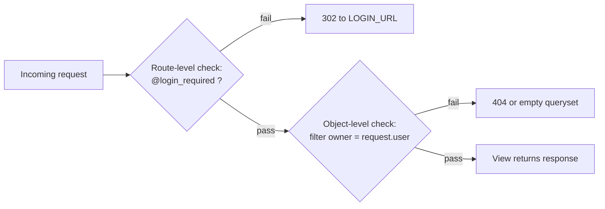

# Phase 2.6 — Access control: who sees what

## 🎯 Goal
Make the home page branch on auth state (anonymous → marketing copy; authenticated → "go to your diary"). Establish the project-wide convention that every notes/calendar/summary view will require login. Write your first automated test to prove it.

## 🧠 Concepts you'll meet
- **The two layers of access control** — route-level (`@login_required`) and object-level (`.filter(owner=request.user)`).
- **Why middleware isn't the only answer** — and when `LoginRequiredMiddleware` is worth it.
- **Django's test client** — a lightweight browser you drive from Python.
- **The first test** of this project — proves a security property, not a happy path.

## 🤔 Why we're doing this now
Everything from Phase 3 onward (`Note`, calendar views, summarizer) must be user-scoped. Setting the convention + a test *now* means every future view starts from a safe baseline. A missing auth check in Phase 5 is a data leak; writing the pattern into Phase 2 prevents it.

## 🗺 The two layers (both are required)



- **Layer 1** keeps strangers out.
- **Layer 2** keeps authenticated users out of *each other's* data.
- **Skipping either is a bug.** Phase 3 will install Layer 2 via `get_queryset()`.

## ⌨️ Commands — you type these

### 1. Feature branch

```bash
git checkout -b feature/2.6-access-control
```

### 2. Make `home` branch on auth state

Edit `notes/views.py`:

```python
from django.shortcuts import render


def home(request):
    """Landing page.
    - Anonymous: marketing copy inviting signup/login.
    - Authenticated: a 'go to your diary' CTA (will link to the calendar in Phase 4).
    """
    return render(request, "home.html")
```

(The view itself is unchanged — the branching logic lives in the template, because the content differs but the route doesn't.)

Edit `templates/home.html`:

```html


SummerNote &middot; Home



    <section class="hero">
        <h1>Welcome back, {{ user.profile.display_name|default:user.username }}.</h1>
        <p class="lead">Jump into your diary.</p>
        <p class="status">
            The calendar view lands in Phase 4. Until then,
            <a href="">tweak your profile</a>.
        </p>
    </section>

    <section class="hero">
        <h1>SummerNote</h1>
        <p class="lead">
            A simple notepad backed by a calendar &mdash; and an AI that can summarize your day.
        </p>
        <p>
            <a class="cta" href="">Sign up</a>
            or <a href="">log in</a>.
        </p>
    </section>


```

Add CTA styling to `static/css/styles.css`:

```css
.cta {
    display: inline-block;
    padding: 0.6rem 1.2rem;
    background: var(--accent);
    color: white;
    border-radius: 4px;
    text-decoration: none;
    margin-right: 0.5rem;
}

.cta:hover { opacity: 0.9; }
```

### 3. Capture the project convention in writing

So no one (including future-you) forgets. Create `docs/conventions.md`:

```markdown
# Project conventions

## Access control
- **Every view that touches user data uses `@login_required`.** Exceptions: home page, signup, login, password reset.
- **Every queryset that returns user data filters by `owner=request.user`.** Never `.all()`.
- **Every destructive action (edit/delete) re-checks the object belongs to the user.**

## URL naming
- App-local URL names: lowercase_snake, e.g. `notes:detail`, `accounts:profile`.
- Never hardcode a path in templates or views; always `` / `reverse('app:name')`.

## Templates
- Project-level `templates/base.html` is the only entry template.
- Per-app templates live under `templates/<app>/`.

## Forms
- State-changing requests are always `POST`.
- Every HTML form has ``.
- After a successful `POST`, redirect (PRG pattern).

## Secrets
- Only via `.env` + `config()`. Never hardcoded.
- Any new env var is also added to `.env.example`.
```

### 4. Write the first test — prove `/accounts/profile/` rejects anonymous users

Replace `accounts/tests.py` with:

```python
from django.contrib.auth.models import User
from django.test import TestCase
from django.urls import reverse


class AccessControlTests(TestCase):
    """Baseline security: unauthenticated users can't reach user-scoped pages."""

    def test_profile_requires_login(self):
        url = reverse("accounts:profile")
        response = self.client.get(url)
        # @login_required should 302 to the login page with ?next= preserved.
        self.assertEqual(response.status_code, 302)
        self.assertIn(reverse("accounts:login"), response.url)
        self.assertIn(f"next={url}", response.url)

    def test_logged_in_user_sees_profile(self):
        User.objects.create_user(username="alice", password="correct-horse-battery-staple")
        self.client.login(username="alice", password="correct-horse-battery-staple")
        response = self.client.get(reverse("accounts:profile"))
        self.assertEqual(response.status_code, 200)
        self.assertContains(response, "Your profile")

    def test_home_shows_different_content_for_auth_state(self):
        anon = self.client.get(reverse("notes:home"))
        self.assertContains(anon, "Sign up")

        User.objects.create_user(username="bob", password="correct-horse-battery-staple")
        self.client.login(username="bob", password="correct-horse-battery-staple")
        authed = self.client.get(reverse("notes:home"))
        self.assertContains(authed, "Welcome back")
```

**What's going on:**
- `TestCase` wraps each test in a DB transaction and rolls back → tests don't pollute each other.
- `self.client` is a fake browser; it handles cookies, follows redirects on request (we check `response.status_code` before following here), etc.
- `User.objects.create_user(...)` properly hashes the password — unlike `User.objects.create(...)` which doesn't.
- `self.assertContains` checks the response body contains a string **AND** that the status is 200. One line, two guarantees.

### 5. Run the test suite

```bash
python manage.py test accounts
```

**Expected output:**
```
Found 3 test(s).
Creating test database for alias 'default'...
System check identified no issues (0 silenced).
...
----------------------------------------------------------------------
Ran 3 tests in 0.XXXs

OK
Destroying test database for alias 'default'...
```

If any fail — read the traceback, fix, re-run.

**Note:** Django creates a *separate* test database per run (`test_<your_db>`) and destroys it after. Your real `db.sqlite3` is untouched.

### 6. Smoke test manually too

```bash
python manage.py runserver
```

- Visit `/` logged out → see Sign up / Log in CTAs.
- Log in → `/` now says "Welcome back, …".
- Visit `/accounts/profile/` → works.
- Log out → `/accounts/profile/` redirects to `/accounts/login/?next=/accounts/profile/`.

### 7. Commit, push, PR, merge

```bash
git status
git add -A
git commit -m "feat(2.6): auth-aware home, conventions doc, first access-control tests"
git push -u origin feature/2.6-access-control
gh pr create --base main --head feature/2.6-access-control \
  --title "feat(2.6): access control baseline + first tests" \
  --body "Phase 2.6 — home.html branches on auth state; docs/conventions.md captures the access-control rules the rest of the project follows; three accounts tests prove the baseline (profile requires login, auth shows profile, home differs by auth state)."
```

Merge, delete branch, sync local.

## ✅ Validation — you've finished this phase when
- [ ] `/` logged out → marketing copy with Sign up / Log in links
- [ ] `/` logged in → "Welcome back" with a Profile link
- [ ] `/accounts/profile/` logged out → 302 to `/accounts/login/?next=/accounts/profile/`
- [ ] `python manage.py test accounts` → 3 passed
- [ ] `docs/conventions.md` committed

## 🧪 Try breaking it (optional)
1. Delete `@login_required` from `profile()` and re-run `python manage.py test accounts`. Two tests fail with helpful messages. Put it back. **Lesson:** tests catch regressions you'd otherwise ship.
2. In `test_logged_in_user_sees_profile`, change the login password to something wrong. The test fails because `self.client.login()` returned `False` and the GET then redirects to login. Fix. **Lesson:** `self.client.login()` returns a boolean — check it when debugging.
3. Try `python manage.py test` (no app name) → runs **all** tests across all apps. There's only one app with tests so far. **Lesson:** scope your test runs when iterating, run everything in CI.
4. Set a breakpoint in `profile()` with `import pdb; pdb.set_trace()`. Run the test. The debugger drops you into a REPL mid-test; `n` step, `p request.user` inspect, `c` continue. **Lesson:** `TestCase` is just Python; `pdb` works inside it.

## 📝 Reflect
- In your own words: why isn't `@login_required` alone enough? Describe a concrete scenario where it passes but a user still sees data they shouldn't.
- The project convention says "never `.all()` on user data." Imagine a line of code that violates this. Where would the bug show up — in dev, in prod, both?
- Why did we write a security test (negative case: anonymous blocked) *before* a happy-path test (positive case: logged-in user sees page)?

## 🔗 Deeper reading
- `@login_required` and `LoginRequiredMiddleware`: https://docs.djangoproject.com/en/5.2/topics/auth/default/#limiting-access-to-logged-in-users
- Testing in Django: https://docs.djangoproject.com/en/5.2/topics/testing/overview/
- Testing tools (client, assertions): https://docs.djangoproject.com/en/5.2/topics/testing/tools/

## ➡️ Next
**Phase 2 complete.** Next up: **Phase 3** — the `Note` model, notepad UI, create/edit/delete.
