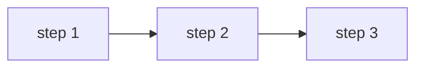

# Phase X.Y — <Short title>

## 🎯 Goal
<One sentence of what you'll have working at the end of this phase.>

## 🧠 Concepts you'll meet
- Concept 1
- Concept 2

## 🤔 Why we're doing this now
<2–4 sentences placing the step. What problem does it solve? What does the next phase assume we've done here?>

## 🗺 Flow



## ⌨️ Commands — you type these

### 1. <What this step does>

```bash
some command
```

**What this does:** <plain-English explanation>
**Expected output:** <what you should see>
**If something went wrong:**
- Error X → Fix Y
- Error Z → Fix W

### 2. <Next step>
...

## ✅ Validation — you've finished this phase when
- [ ] Concrete check 1
- [ ] Concrete check 2
- [ ] Concrete check 3

## 🧪 Try breaking it (optional)
1. <Thing to try> — what happens? Why?
2. <Thing to try> — what happens? Why?

## 📝 Reflect
- Question in your own words 1
- Question in your own words 2

## 🔗 Deeper reading
- [Official doc link]

## ➡️ Next
`<next-phase-file>.md`
